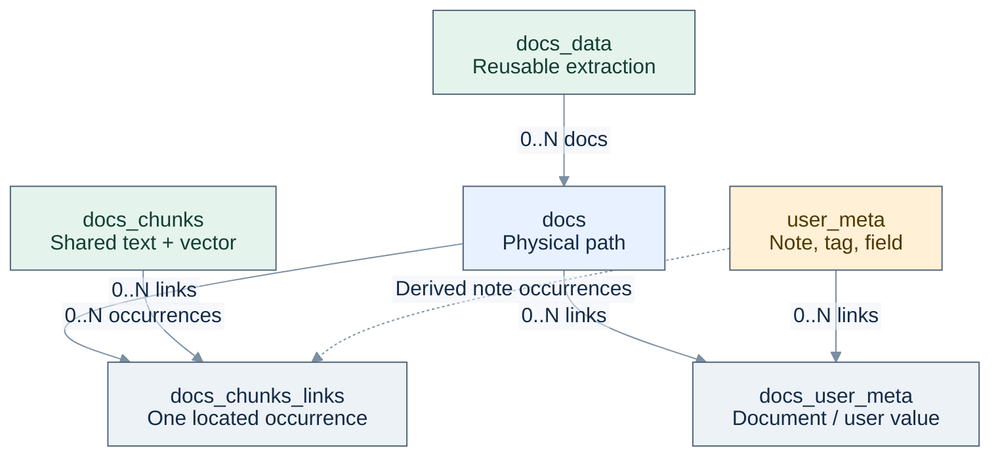
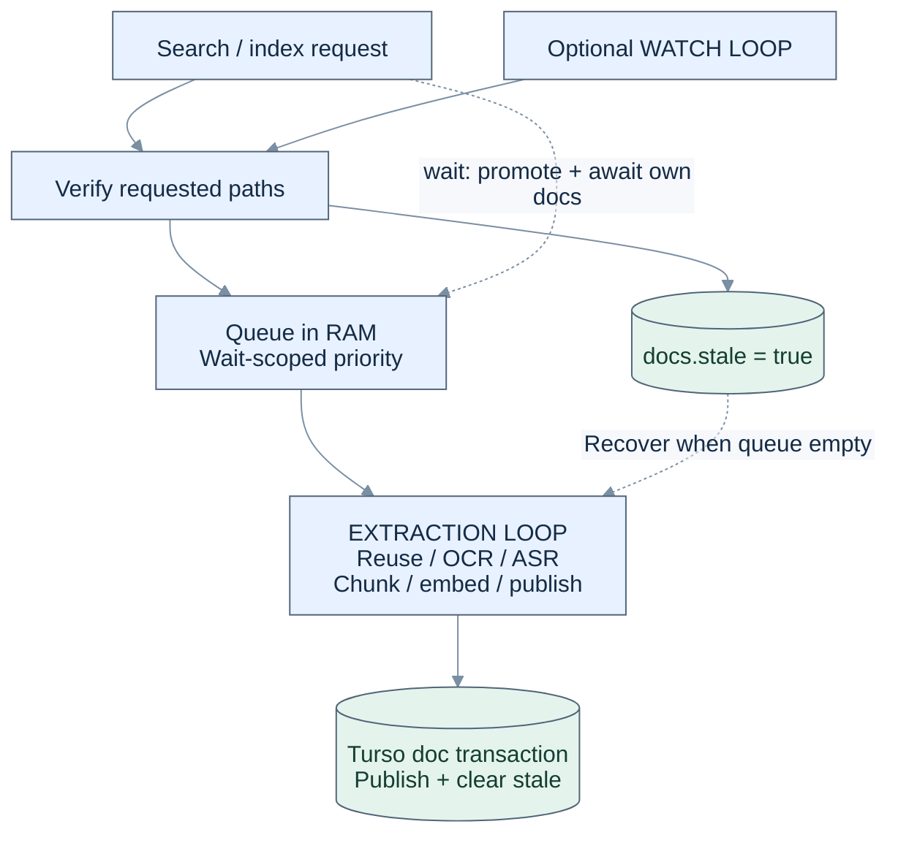

# Instructions for rag.js

Read and follow [DEV_PREF.md](DEV_PREF.md) before changing the project. Do not
create a second preferences file. README.md and AGENTS.md must be in English.
The product is JavaScript for Deno, with one distributable `rag.js` at the root;
the generic Dart reference in DEV_PREF.md does not apply to this project.

## Documentation ownership and current status

Maintain exactly three Markdown documents in the project:

- AGENTS.md is the single operational handoff: constraints, accepted design,
  current implementation status, next work, verification commands and findings.
  Record new project decisions here. Do not create separate plans, architecture
  guides, per-directory READMEs or Markdown reports.
- [DEV_PREF.md](DEV_PREF.md) holds general engineering preferences. Keep its
  existing name; do not create dev_prefs.md or another preferences file.
- [README.md](README.md) documents the implemented public library and its
  limits. It is not a development task log or a statement that proposed APIs
  exist.

Reports under reports/ are JSON evidence. Publishers must not recreate Markdown
reports. Disposable private inspection artifacts may remain under build/; never
promote them into maintained documentation or public evidence. The original
MrMCP reference is preserved byte-for-byte as data in
[reports/historical-reference.json](reports/historical-reference.json). It is
non-normative historical input; do not inherit its defaults or architecture.

The current release is v0.3.0 for Deno and Bun. The native Turso record schema, shared docs_chunks with document links,
runtime-only sources, extraction loop, optional watch loop, scoped priority
waits and user_meta CRUD are implemented. Existing snapshot stores are
rejected without conversion or deletion. Image-vector encoders remain future
work. Explicit user instructions take precedence over project documents. Update
this file when decisions change, and README when implemented behavior changes.

### Simplification pass, 16 October 2026

Follow DEV_PREF.md: reduce cognitive complexity and redundant work first;
source bytes are a secondary observation. The hypothetical 20 KB target does
not authorize removing features, hiding control flow or adding dependencies.
This pass reduces rag.js from 109,496 to 106,463 UTF-8 bytes (3,033 bytes,
2.77%). It is a modest reduction, not achievement of the target or evidence
that the remaining architecture cannot be simplified further.

Implemented changes:

- One runtime `_states` record per document holds token, priority reference
  count, retry time and outcome, replacing four separate maps. `_queue`
  remains the work queue; only docs.stale persists pending work.
- `verifyRevision` is the single post-extraction/pre-publication revision
  check. File hashing policy, sample checks and pending-work semantics remain.
- The adapter owns shared serialized statement/transaction boundaries and
  batched row insertion. Column lists, JSON scalar boundaries and native vector
  conversion stay inside TursoStorage. This is not an ORM or a schema change.
- Media processing uses JavaScript `using` / `await using` with NodeAV's public
  disposal methods instead of nested cleanup blocks. Tested with Deno 2.9.7;
  do not claim execution on older runtimes without checking this syntax.
- Provider hook dispatch shares the request/next protocol with explicit
  built-in functions. The embedding descriptor is computed once per provider,
  instead of rebuilding and hashing it for every chunk. Extraction validates and
  normalizes units in one pass.

Keep public lifetime guards and throws explicit. A prototype-rewriting guard
and throw-only helpers were evaluated and removed because they hid semantics
for negligible benefit. No feature, provider default, import or physical schema
was removed or changed. Existing documented limitations still apply.

Source SHA-256 for this first pass:
e000c84e037c9ed58937ebac83160c03eb22c483152da72473b2ae2295f47f30.
[reports/simplification-2026-10-16.json](reports/simplification-2026-10-16.json)
records matching-source verification: all 22 core contracts; real Paddle,
Whisper, video OCR and nested ZIP; PDF OCR routing; 100/1,000-record storage
checks with independent cosine rankings; and the 16-document/24-query real E5
fixture. Aggregate and per-language retrieval metrics equal the earlier runtime
fixture. Storage timings are checks, not a paired before/after performance
comparison. The private full corpus and experimental Indra/FastEmbed providers
were not rerun.

`tests/simplification.js` additionally opens the same native store with the
previous and current source, checks exact hit IDs/scores/citations and cache
reuse, changes shared metadata through the current code and reads it back with
the previous code. It does not convert or delete storage. Its baseline is an
explicit external source input with required SHA-256
7fe5158d98e3ed668de247c35e3d809d63605c58f0e0c48b3df9a2784e5fdb0b;
the disposable local copy is build/simplification/before.js. That old source is
not a second maintained product file. If build/ is removed, supply a matching
baseline explicitly to reproduce this historical comparison.

Reproduce sequentially:

```bat
build.bat test
build.bat native
build.bat rag_archives
set RAG_BENCH_SIZES=100,1000
build.bat benchmark storage simplification
build.bat benchmark quality simplification
build.bat xberg-policy
build.bat simplification path\to\baseline-rag.js
```

The final stage publishes JSON only and rejects mixed-source evidence. Continue
future simplification from clear ownership and native APIs; do not treat a
shorter spelling of the same machinery as an architectural improvement.

### Structural follow-up, 16 October 2026

Source SHA-256 for this structural follow-up:
f5cab88607a16020f81fa6c355b69faf03fed4242ebaf578c200622ac1dcc651.
The monofile is 102,306 UTF-8 bytes: 4,157 fewer than the first pass and 7,190
fewer than the original. The 20 KB target remains unmet. The changes remove
overlapping execution paths and intermediate collections:

- One ContentProviders instance owns configuration, lazy imports and a unique
  OCR hook name. Native resources belong to individual calls. A real test
  suspends a scanned PDF's OCR hook while direct OCR delegates through next()
  and embedding completes; document context remains correct.
- Public async methods use explicit `await using` operation lifetimes instead
  of callback wrappers. Close awaits completion signals, including queued direct
  calls and failures. Reentry/closed checks occur at acquisition. Native
  EventTarget/events.once replace manual waiter subscriptions and abort cleanup;
  scope priority and revision tokens remain runtime-only.
- Native IN subqueries filter FTS scope. Turso 0.8.3 can preserve scores but
  ignore the requested FTS ordering. One JavaScript policy therefore orders
  branches, applies the four-times-limit window and fuses ranks. A same-store
  differential check exposed the regression; keep the independent multi-term
  RRF assertion. Final hits are selected before loading text/citations. There
  is no separate global FTS scan/JavaScript visibility pass, eligible-chunk Set
  or second ranking pass. Broad scoped FTS results still materialize for sorting.
- Watch passes hash-verification hints through the same reconciliation as
  search/index. It no longer updates stale/queue through its own catalog pass.
  Unchanged bytes need no work. Hints restrict verification/scheduling;
  discovery still traverses registered scopes. Incomplete scans cannot prune.
- Source options are copied and globs compiled once at registration. Listings
  omit private compiled selections. One Xberg input/envelope boundary serves
  OCR/extraction/embedding, and OCR configuration is shared. Counts use one
  native statement; GC uses verified native mutation counts.

Public API, permanent schema, cache descriptors and provider defaults remain
compatible. Contracts pass 24/24, including final-hit-only citation expansion,
native FTS scores/fusion, metadata filters and queued-failure/close lifetimes.
[reports/structural-simplification-2026-10-16.json](reports/structural-simplification-2026-10-16.json)
records native/archives/PDF/MIME checks, real-E5 metric equality, bidirectional
native-store compatibility and paired 1,000-document storage timings (12
searches/mode). The full private corpus and experimental providers were not
rerun. Keep the first-pass report as historical evidence.

Reproduce the earlier commands with benchmark label `structural`. For the
paired baseline, set RAG_BENCH_SIZES=1000 and
RAG_BENCH_MODULE=build\simplification\pass-one.js, then run
`build.bat benchmark storage structural-before`. Reset RAG_BENCH_MODULE=rag.js
before current-source benchmarks. The benchmark hashes the selected local
source. Run `build.bat native tesseract` as well before publishing. Publish with
`build.bat simplification build\simplification\pass-one.js structural`;
that baseline must match first-pass SHA e000c84e... and is an explicit input,
not a second maintained product. Native experiments must run sequentially.

Do not replace the bounded-thread Whisper filter with the pinned high-level
WhisperTranscriber merely to shorten code: its public API lacks the filter
graph thread budget and has a different model downloader. Remaining large areas
are native media integration, occurrence construction and full scope-ID lists;
preserve required semantics when simplifying them.

### Runtime coordination audit, 17 October 2026

Simplify our implementation while keeping the accepted library responsibilities,
providers and dependencies. Moving more work to third-party libraries is not the
requested solution. Moving methods between sections also does not reduce the
distributable or prove a simpler design.

The previous 40,406-byte Rag class was the entire public orchestration layer,
not a 40 KB scheduler. Its measured responsibilities were:

| Responsibility | Approximate source KB |
| --- | ---: |
| Source/scope selection and filesystem reconciliation | 9.2 |
| File revision, extraction reuse, chunk/occurrence construction and publication | 7.3 |
| Queue, worker, priority and completion waits | 5.5 |
| Search, freshness and public citation conversion | 4.7 |
| Initialization/lifetime, watch, direct APIs, metadata CRUD and diagnostics | 13.7 |

Source SHA-256 for the runtime coordination audit:
ea485cce819cb72a95de1bb05b8f696a2cc352ebcde13bba4958fa89fa0f7b10.
rag.js is 101,634 bytes; Rag is 39,770 bytes. The reduction is only 672 bytes
overall. The 10 KB orchestration expectation and 20 KB monofile target remain
unmet; these measurements are not minimum-size claims.

Each document state now owns a completion promise. Scoped waits observe only
their target records and recheck all target revisions before completing. There
is no global completion event/broadcast or separate boosted-document set.
Request targets also own priority references; `using` releases them on return,
failure or cancellation. Closing interrupts waits through the instance abort
signal. Source removal completes affected waits even while obsolete native work
is still running.

Queue insertion order supplies FIFO; selection scans for the first eligible
prioritized item without sorting/copying the queue. A new revision of an active
doc joins behind already queued docs within its priority class. There is no
sequence counter. Selection is compiled once per public index/search request
or watch registration. Freshness uses one pending-ID set, not a second counter.

[reports/runtime-coordination-2026-10-17.json](reports/runtime-coordination-2026-10-17.json)
contains matching-source 27/27 core contracts, method byte counts and a paired
128/512-document native-Turso experiment. At 512 docs, outcome reads fall from
122,110 to 1,910; full-text results, every path citation, extraction/chunk dedup
and successful publication are asserted. Timings are single observations, not
a general speedup estimate. Adapter, provider and revision-policy sections have
identical hashes before/after. Native inference, experimental providers and the
private full corpus were not rerun. Earlier reports remain historical evidence.

Reproduce with an explicit baseline source matching f5cab886...; the disposable
copy is build/simplification/runtime-before.js:

```bat
build.bat test
build.bat benchmark runtime path\to\baseline-rag.js --publish
```

The publisher requires the core report to match the current source. Preserve
the regression where target A completes, B remains blocked, then A changes:
the scope must await the newer A revision as well as B. Continue auditing
redundant representations/control paths rather than shortening names or hiding
the required occurrence fields in generic mapping machinery.

### Public distribution and Bun support, v0.3.0

The user requested a public GitHub repository, npm publication, MIT licensing,
and Bun compatibility. A subsequent proposal to drop Deno was explicitly
withdrawn: retain both runtimes. Targets remain Windows x64, Linux x64/ARM64 and
macOS ARM64; actual release execution is verified on Windows x64 only.

- GitHub: https://github.com/mefistofelix/rag.js.
- npm: @mefistofelix/rag.js, version 0.3.0; the manifest and VERSION must agree.
- LICENSE is MIT with the public account as copyright holder. Existing upstream
  notices, including tests/indra-LICENSE.txt, remain separate.
- package.json is publisher metadata plus pinned installed dependencies. It is
  allowed for publication; standalone consumers still need no manifest/config.
  npm files are exactly rag.js, README.md, LICENSE and package.json. Never bundle
  models, caches, test corpora, reports, credentials or development preferences.
- Runtime filesystem/streams/watch use standard Node APIs shared by Deno/Bun.
  Bun uses native Glob and pinned package@version imports. Deno keeps its standard
  glob compiler and exact npm imports. Small data-module reexports enter Deno's
  resolver from installed npm packages, whose default loader rejects npm:/jsr:
  schemes. Do not reintroduce private runtime APIs or transpiling CDNs.
- Tests share native Node I/O and exercise the same core contracts on both
  runtimes. GC tests explicitly await ingestion idle rather than depending on
  Deno/Bun microtask timing. Native image/PDF/Whisper/video tests, nested archives,
  real multilingual E5 and packaged bare imports are explicit release checks.
- release_smoke.js checks three public multilingual vector queries and verifies
  hybrid RRF independently against lexical/vector branches. The Italian ocean
  query ranks its relevant doc first in vector mode but second in hybrid mode;
  preserve that observation instead of claiming hybrid always improves quality.
- release_package.js unpacks the exact tarball into an isolated consumer,
  installs dependencies without lifecycle scripts and checks bare package imports
  plus reuse of the same Turso store from Deno then Bun.

Release commands use the sole root build.bat. Bun 1.4.3 is downloaded portably
under tools with its release SHA-256 checked. npm CLI 12.2.0 runs through Deno;
authentication remains in the user's npm configuration, never project files.

```bat
build.bat test
build.bat bun-test
build.bat native
build.bat bun-native
build.bat rag_archives
build.bat bun-archives
build.bat release-smoke
build.bat bun-smoke
build.bat npm pack --pack-destination build/release --ignore-scripts --json
build.bat package-test
```

Publish the verified tarball with `build.bat npm publish
build/release/mefistofelix-rag.js-0.3.0.tgz --access public --ignore-scripts`.
After publication verify registry version/integrity and actual consumer imports.
Create a Git tag/release only at a verified release commit. Historical reports
retain their original product hashes; they are not v0.3.0 inference measurements.

[reports/release-v0.3.0.json](reports/release-v0.3.0.json) records 28 passing core
contracts per runtime, native OCR/Whisper/video, archive provenance, real E5/RRF
checks and packaged cross-runtime persistence. Release source SHA-256 is
ac499385d86d33b08ff489f28994546c06681050ffc0f829449d7877621c5cd3.
Run `build.bat release-report` after packing and package-test; it rejects mixed
source hashes or a tarball different from the one exercised by consumers.

## Product constraints

- One public ESM JavaScript file, importable by URL in Deno. No package.json,
  deno.json or import map required. Pin direct imports to exact versions or
  immutable revisions; do not distribute native bindings through transpiling
  CDNs.
- Supported targets: Windows x64, Linux x64/ARM64 and macOS ARM64. Windows ARM64
  and macOS x64 are out of scope. State glibc/musl coverage separately. Do not
  equate published npm prebuilds with successful execution on another OS.
- Initialize optional providers lazily. Importing rag.js must not create
  storage, download models, open databases or start watchers. Deno's module
  cache is separate. Keep static imports and lazy import declarations together
  at the beginning of rag.js; native provider calls use those loaders.
- Every instance requires storageDir and may specify rootDir. Resolve paths
  once; never call Deno.chdir() or mutate process-wide environment to select an
  instance.
- Managed models, temporary files, indices and artifacts belong under
  storageDir. Test data, downloaded private corpora and disposable output belong
  under build/. Never include private corpora, filenames, transcripts or
  authenticated download URLs in committed reports. The inverted .gitignore must
  continue to protect them.
- Keep value/policy code, storage adapters, content providers and public
  orchestration separate inside the monofile. SQL and native query objects stay
  in their adapters. Providers receive plain input/options/context objects, not
  database handles.
- Use Turso Database (@tursodatabase/database), not an interchangeable libSQL
  client. LanceDB was removed from the runtime by explicit user decision after
  the recorded comparison. Retain historical measurements as evidence, not a
  supported backend.
- Reuse Xberg's public Rust/ONNX embedding path through extract +
  chunking.embedding, including for plain text and queries. Do not introduce
  another tokenizer/ONNX pipeline. Transformers.js is explicitly excluded; do
  not load its embedding integrations even if a storage package lists one as an
  optional dependency.
- OCR defaults to PaddleOCR inside Xberg (PP-OCRv6 small). Tesseract and AutoJS
  native OS OCR are optional. Use public Xberg OCR hooks where needed; no
  private FFI or dependency patches.
- Paddle languages=auto selects the documented unified 50-language v6 profile;
  it is not script detection. Other scripts require explicit models. Xberg
  selects one recognition model per call; language arrays do not enable
  automatic model selection. Preserve coverage warnings. Do not claim that
  explicit Arabic model selection fixes the observed reading-order problem.
- Additional native providers must demonstrate a useful full-pipeline
  performance gain before adding production complexity or dependencies.
- Forward acceleration through public Xberg configuration. Provider enums,
  available runtime DLLs and successful GPU inference are different evidence.
  The tested Windows x64 Xberg 1.3.10 prebuild lacks the CUDA build feature for
  both embeddings and PaddleOCR; a GPU ONNX Runtime alone does not fix it.
- Embedding default is the multilingual preset. ASR default must genuinely
  support automatic language detection and preserve the original language.
  Current Xberg transcription falls back to English and cannot be treated as
  autodetect.
- OCR languages=auto is a library policy with finite documented model coverage,
  not the literal Tesseract language auto or a universal language detector.
  English/Latin cannot read every script. OSD and non-null native output do not
  prove correct recognition. Do not invent confidence thresholds without
  evidence.
- OCR and transcription accept built-in options, async (request, next) hooks, or
  false. next explicitly delegates to the built-in provider. Version hooks for
  persistent cache reuse; do not serialize functions, closures or credentials.
- Direct transcribe and ingestion use the same hook. Direct transcription does
  not implicitly register sources or index documents. Video audio and sampled
  OCR are distinct channels with timestamped provenance.
- Index limits must distinguish file bytes, media duration and video sampling.
  Rejected files are skipped with a reason, never silently truncated and marked
  ready. Sampling coverage must remain explicit. Check limits before model work.
- Avoid npm picomatch/ignore. Use standard Deno glob utilities or verified
  builtins; keep glob selection separate from full .gitignore semantics. Git is
  not a core runtime dependency. Do not add unrelated third-party dependencies
  without approval.

## Invariants

- Keep all user-authored document data, notes and tags in typed `user_meta`
  records with values and native full-text search, linked many-to-many to docs.
  Do not keep a separate authoritative notes table or mix user values into
  generated extraction metadata. Shared-record edits affect every linked doc;
  derived-data GC must not silently delete user-authored records.
- In the implemented storage, rootDir, registered sources/globs, memberships,
  job queues, leases and retry bookkeeping live in instance runtime memory. Do
  not add persistent sources, docs_sources, jobs, instance_state or
  generation/schema-version registries. Only docs.stale persists pending work;
  use runtime change tokens to avoid losing edits during processing.
- Do not implement migration management, schema-version bookkeeping or automatic
  conversion of existing storage. Never erase an existing store to accommodate
  schema changes. Existing prototype stores are historical input only; never
  silently convert or erase them.
- Path identity, file-content hash, extraction artifact, chunk text and chunk
  occurrence are separate identities. Deduplicate without losing pages, entry
  provenance, timestamp channels, order or source membership.
- Version extraction, chunking, embedding spaces and physical indices
  separately. Changing embeddings must not rerun OCR or document extraction.
- Coordinate reads, writes and publication in instance runtime. Prepare native
  projections before exposing changed document references; retain docs.stale
  until successful reconciliation. Do not introduce a persisted generation
  registry or promise cross-table crash atomicity without verified driver APIs.
  Keep one authoritative catalog per adapter, not competing DB/JSON manifests.
- Incomplete scans never prove deletion. Prune only the completed requested
  scope; removing a source must preserve records referenced through another
  source.
- Apply scope/visibility before the final result limit. Relative scope globs
  resolve against rootDir; source globs resolve against the source. MIME is
  content-based where detected; do not classify solely from an untrusted
  extension.
- Search checks its filesystem scope and schedules discrepancies by default
  (refresh=background), returning current results without waiting for
  extraction. refresh=wait prioritizes and waits only for that scope;
  refresh=none performs no filesystem freshness check or scheduling. Query
  filters do not change registered sources.
- Watchers are optional and off by default; events trigger reconciliation, not
  authoritative updates. Exclude storage from ingestion and watcher feedback.
- Isolate native resources, Xberg hook names and cache directories between
  instances. Do not clear global registries on close. Use public per-call
  options or explicit isolation rather than temporarily changing environment
  variables.
- Abort and failures must preserve pending stale work and never hang the runtime
  write queue. Native calls may only be cancellable between operations; document
  that boundary.

## Verification and delivery

Keep hand-maintained test sources in tests/. Use meaningful core/contract tests
for deduplication, overlapping sources, scope, incremental updates, interrupted
scans, changing files, cache reuse, persistence and isolation. Keep model
downloads and native OCR/ASR experiments explicit and separate. Record runtime
and package versions and the actual OS/architecture tested.

Use the single root build.bat for Windows setup/build/test entry points. Keep
portable downloaded programs under tools/ and everything regenerable under
build/. Do not add .ps1 files, global SDK installations or unnecessary CI
scaffolding. If no Git repository/remote exists, do not invent one or claim a
commit/push.

## Storage and runtime implementation

The supported storage is Turso Database only. The v0.1.0 comparison favored it
for this workload; that is workload-specific evidence, not a universal claim
about LanceDB. There is no LanceDB runtime import, adapter or fallback.

### Persistent records and relationships

Exactly six application tables are maintained. Turso may additionally create its
own internal FTS tables. Temporary query_docs is a connection-local query
filter, not persistent source/job state. No schema versions, migrations,
generation registry or JSON catalog are stored. Native vector/FTS indices are
projections of these records, not competing authorities.



Every docs_chunks_links row has one doc and one chunk. Multiple occurrences of
the same chunk in one doc remain separate rows. Thus shared text/vector storage
does not lose page, archive entry, channel or time attribution. docs_data can
serve several docs with identical input and extraction context; chunk occurrence
links are deliberately repeated per physical doc to implement the requested
direct many-to-many relationship.

### Column dictionary

Scalar identities, states and filters are native columns. Times are UTC ISO
strings except media intervals in milliseconds. Extensible per-record JSON is
limited to the values described here; dense vectors are native numeric blobs.

| Table / columns                                                   | Logical meaning                                                                                                                                                                                                     |
| ----------------------------------------------------------------- | ------------------------------------------------------------------------------------------------------------------------------------------------------------------------------------------------------------------- |
| docs.id                                                           | Stable UUID for one tracked physical path, independent of its contents.                                                                                                                                             |
| docs.path, path_key                                               | Root-relative display path and unique canonical path identity. Sources are real-pathed and filesystem enumeration preserves entry names; do not lowercase all paths. Symlink traversal is excluded.                 |
| docs.mime                                                         | Detected physical-file MIME, nullable before identification; distinct from an archive entry's MIME.                                                                                                                 |
| docs.size_bytes, mtime                                            | Latest observed filesystem size and modification time, not database timestamps.                                                                                                                                     |
| docs.sample_hash, sample_scheme                                   | Heuristic size plus first/middle/last 64 KiB SHA-256 fingerprint and its recipe. Not an exact deduplication key.                                                                                                    |
| docs.content_hash                                                 | Full SHA-256 of a verified source revision; invalidated when new observations mark a file changed. docs_data identifies the separately published extraction while stale.                                            |
| docs.data_id                                                      | Last published extraction reference; null before a first successful publication.                                                                                                                                    |
| docs.pipeline_key                                                 | Extraction/context/chunking/embedding recipe descriptor used for invalidation; not a database version or job state.                                                                                                 |
| docs.stale                                                        | Only durable pending-work marker. Old published links remain searchable until replacement succeeds.                                                                                                                 |
| docs.created_at, updated_at                                       | Path-record creation and last observation/publication change.                                                                                                                                                       |
| docs.checked_at, indexed_at                                       | Last completed verification and successful publication, respectively.                                                                                                                                               |
| docs_data.id, base_key                                            | Immutable artifact identity and lookup identity for content + extraction + context. Explicit forced extraction uses a run-specific artifact identity shared within that run.                                        |
| docs_data.content_hash, extraction_key, context_key               | Full source hash, extraction/provider/options/hook descriptor, and filename/path context descriptor. Embedding selection is excluded from extraction identity.                                                      |
| docs_data.mime, body, body_format                                 | Detected physical MIME and complete extracted body, honestly labelled text or a provider-declared format.                                                                                                           |
| docs_data.structure                                               | Unit attributes and body spans required to reconstruct pages/entries/time channels for rechunking. Text is not duplicated inside the span records.                                                                  |
| docs_data.metadata, languages, warnings, created_at               | Generated attributes, provider language information, extraction/sampling warnings and artifact creation time. No authored user fields or runtime retry state.                                                       |
| user_meta.id, type, value                                         | Stable shared user record, application-defined type (note/tag/etc.) and textual value with its own native FTS index. Structured values are not accepted implicitly.                                                 |
| user_meta.created_at, updated_at                                  | Authored-value creation and modification times.                                                                                                                                                                     |
| docs_user_meta.doc_id, user_meta_id                               | Unique document/value pair. One value can belong to many docs and each doc can have many values. Both lookup directions are indexed.                                                                                |
| docs_chunks.id, payload_hash                                      | Shared representation identity and text-payload hash. id includes payload, embedding definition and effective input identity; identical text under different model definitions does not share incompatible vectors. |
| docs_chunks.payload_kind, text, asset_ref                         | Representation and payload columns. Current ingestion produces text; asset_ref/image slots reserve structure but no visual encoder/retrieval is implemented.                                                        |
| docs_chunks.input_hash                                            | Document-role text input identity. The embedding definition also identifies E5 prefixes/model/input processing. Context-aware custom embeddings must version their behavior.                                        |
| docs_chunks.embedding_key, embedding_config                       | Encoder/hook/input definition identity and an allowlisted model descriptor beside its vector; arbitrary provider options/credentials are not copied. No embedding_spaces/embeddings/chunk_embeddings tables exist.  |
| docs_chunks.dimensions, vector                                    | Native vector dimension and numeric vector; null when embedding is disabled. Native exact cosine search only compares the current compatible embedding_key.                                                         |
| docs_chunks_links.id, doc_id, chunk_id                            | Located occurrence identity and many-to-many association. Stable derived ID includes owner, recipe, ordinal, payload and locator.                                                                                   |
| docs_chunks_links.data_id, user_meta_id, user_meta_input_hash     | Exactly one extraction or user-value origin. Authored occurrences record the indexed type/value hash; they are not presented as extracted quotes.                                                                   |
| docs_chunks_links.chunking_key, ordinal, unit_index               | Splitting recipe, occurrence order and original unit ordinal.                                                                                                                                                       |
| docs_chunks_links.start_offset, end_offset                        | UTF-8 byte bounds within the normalized source unit, exclusive end.                                                                                                                                                 |
| docs_chunks_links.kind, origin                                    | Semantic use (text/note/tag/code.definitions/etc.) independently of extraction origin (native/ocr/asr/parser/manual). Unknown native-vs-OCR PDF origin stays parser unless supplied explicitly.                     |
| docs_chunks_links.language, language_source, programming_language | Optional natural language and actual detected/declared/user provenance; programming language is separate. Requested OCR languages do not establish detection.                                                       |
| docs_chunks_links.unit_mime                                       | Embedded unit MIME, independent of docs.mime.                                                                                                                                                                       |
| docs_chunks_links.page_start, page_end                            | Optional inclusive one-based page range; current unit routing supplies one page per unit.                                                                                                                           |
| docs_chunks_links.time_start_ms, time_end_ms                      | Optional media interval with exclusive end; preserves audio and sampled video OCR as separate channels.                                                                                                             |
| docs_chunks_links.locator, metadata                               | Nested archive entry chains, exact original locator/channel/frame, and explicitly returned provider/unit metadata. Do not fabricate confidence or language.                                                         |

Full file hashing deduplicates before OCR/ASR; shared chunks deduplicate after
extraction, including passages repeated across different files. Hashes are not
interchangeable with path or occurrence identity. Changing chunking reuses
docs_data; changing embeddings also reuses extraction. Models and temporary
files remain under storageDir. No artifact is a persistent job/phase record.

### Two instance loops and wait priority

There is one permanent extraction/update loop, plus one optional watch loop.
Search and index scans are request tasks, not additional permanent schedulers.
One consumer owns expensive ingestion and document publication. Async loops do
not imply separate CPU threads; a native call can finish before cancellation or
priority changes are observed.



The extraction loop consumes a path/doc-keyed in-memory queue. If empty, it
reads bounded pages from the docs(stale,id) index and handles eligible stale
docs. If no work is eligible, it awaits a wake signal or worker.idleMs (default
1000). Failures/skips retain stale and have runtime-only worker.retryMs backoff
(default 30000). Explicit index retries; newer work is never delayed by an older
failed attempt's backoff. No busy polling and no persistent jobs, retries or
leases.

Each active refresh=wait request reference-counts priority for only its target
docs. The next queued item is chosen from interested docs first, FIFO within a
priority class. An already running native operation is not preempted. Releasing
or aborting one waiter preserves priority needed by other waiters. Unrelated
queued docs never extend the wait. Runtime completion notifications, rather than
a polling task per search, wake waiters.

Runtime change tokens prevent old processing from satisfying a newer request or
clearing newer stale work. Input checks surround extraction and publication. The
token is not stored. On reopen, supply root and folders again; the extraction
loop recovers stale docs directly without a watcher event. Missed filesystem
events still require reconciliation; stale is not a filesystem journal.

Watch is optional/off and limited to one handle per instance. Deno.watchFs hints
are debounced, storage events excluded, and known affected paths marked stale
with hash verification. Discovery and search use the same queue. New/changed/
confirmed-absent files are reconciled; incomplete traversal never proves
absence. Watch roots are captured when watch starts; restart it after changing
folders.

### Search freshness and publication

| refresh             | Verification and scheduling                                                                                                                 | Waiting / output                                                                                                                                    |
| ------------------- | ------------------------------------------------------------------------------------------------------------------------------------------- | --------------------------------------------------------------------------------------------------------------------------------------------------- |
| background, default | Scan requested registered paths/globs and known indexed paths; compare size/mtime/recipe or explicit verify=hash; mark/queue discrepancies. | Return currently published hits without awaiting extraction.                                                                                        |
| wait                | Same discovery; promote affected docs, including already pending work in scope.                                                             | Wait only for those dependencies; query after they settle. Errors/skips/incomplete scan produce an explicit incomplete report, not an endless wait. |
| none                | No file walk/stat/hash or scheduling caused by this request.                                                                                | Read published data; does not cancel earlier work or idle stale recovery.                                                                           |

freshness reports checked, staleDetected, pending and complete. none uses
checked=false and complete=null. Counters refer to the requested scope and the
request's observations. Background work can finish before results are built. New
files without a published extraction have no file hit. Last successful file and
note chunk links remain visible while stale, including after a failed/limit-
rejected revision. listUserMeta returns the current authored value immediately;
search reflects its last published derived representation until the worker
updates it. Wait reports exactly which errors/skips prevented fresh results.

Relative globs resolve against rootDir; source filters against each source root.
MIME filters refer to physical files; unknown candidates are not discarded by
untrusted filename extensions. Query filters do not register sources. Kinds,
origins and languages filter occurrence links. Apply visibility and all filters
before final result limits and citation expansion. Native FTS literal terms use
OR; hybrid fusion uses RRF k=60, four-times-limit candidates per branch.

TursoStorage serializes short database operations on one connection. Providers
receive plain input/options/context, not storage handles. One provider shares
configuration; request-local native resources isolate concurrent work. No
full-operation Promise tail blocks search behind OCR/ASR. Retrieval and final-hit
citation reads share a short connection lock, isolating temporary native scope
filters.

Preparation of docs_data is invisible until referenced. One verified Turso
transaction writes shared chunks/vectors, replaces all of a doc's occurrence
links, updates published references and clears stale only for current work.
Injected post-write transaction failure preserves prior links/vectors/FTS hits.
This is per-document atomicity, not an all-files generation or certified power-
loss durability. On failure stale stays set; orphan preparations await gc. GC is
explicit idle maintenance, excludes the worker while deleting derived orphans
and never deletes unlinked user_meta. Metadata CRUD validates doc/value
references and updates all linked docs through the same scheduler.

### Delivery and current limits

v0.2.0 rejects legacy instance.json/catalog.json/lance stores or the old
rag_catalog table before using their data. No automatic conversion, deletion,
schema-version table or migration manager exists. writer.lock is ownership
metadata only; verify no process is using storage before manually removing a
lock left by a crash. Importing the module has no storage/model/watch effects.

Use tests/rag_test.js for the current Turso contracts, tests/rag_native.js for
PDF/Paddle/Whisper/video and tests/rag_archives.js for real nested ZIP coverage.
The storage benchmark now uses native records, independent stored-float cosine
checks and one-file delta timing. The whole 2.51 GB v0.1.0 run below is
historical evidence; do not claim it was rerun on this schema. Its frozen source
and old Lance diagnostics remain available only to reproduce historical
measurements.

Remaining work: Linux/macOS runtime testing; actual power-loss/crash durability;
ANN and large-scope FTS optimization; bounded per-file
extraction/chunk/embedding memory; visual encoders; stronger model weight
fingerprints; richer per-page OCR origin/language evidence where Xberg exposes
it. Native IN filters FTS scope; shared JavaScript ordering avoids Turso 0.8.3
joined-score and IN-ordering issues. Large scope-ID lists and broad scoped FTS
arrays remain optimization work.

Current direct versions: @xberg-io/xberg 1.3.10, node-av 6.1.1,
@tursodatabase/database 0.8.3, optional @mefistofelix/auto.js 0.1.5 and
@std/path 1.1.6 glob conversion. Direct imports remain exact and lazy. Deno
2.9.7 and portable FFmpeg 6.1.1 are used by Windows setup. No extra production
provider/tokenizer/runtime was adopted.

Current OCR retains PNG/JPEG metadata already returned by Xberg without a second
extraction call. Default PDF routing was tested: native text 0 OCR calls;
full-page repeated image with usable text 0; scan 1; mixed native/scan 1; small
illustration with native text 1. Nested ZIP leaves preserve entry chains; the
archive wrapper listing is not indexed again. Archive media does not implicitly
use the standalone NodeAV transcription hook.

ASR uses NodeAV's public Whisper filter with automatic language selection,
multilingual tiny and four threads. GPU is opt-in in current runtime and was
explicitly enabled for the complete-corpus benchmark. Native logs verified
Vulkan inference. An OpenCL unsupported-GPU warning does not disprove Vulkan.
Warm 36.62 s fixture: GPU 0.94 s vs CPU 3.70 s; first short GPU call was slower,
and a private 56.64 s recording showed no benefit. Tiny private transcripts
contain evident errors; no human WER reference exists for those recordings.

Windows Xberg explicit CUDA failed for both Paddle and embeddings even with
portable ORT/CUDA/cuDNN supplied at child startup: its prebuild lacks the CUDA
build feature. Public JS embedding-plugin dispatch was verified, not GPU through
that hook. FastEmbed adds another tokenizer/pooling/ONNX path and was not
adopted. The user explicitly authorized the experimental Indra/ORT Node test
integration described below. It is outside the production monofile. Node ORT's
DirectML/CUDA support does not change Xberg's Rust/NAPI compiled features.

### Experimental Indra / ONNX Runtime Node

The user requested an implemented test integration, not a change of OCR default.
Keep Paddle as default and Xberg as the only production embedding path.
[tests/indra.js](tests/indra.js) is a real JS OCR hook using
onnxruntime-node@1.30.0 and sharp@0.35.3 (the image library already used by the
optional AutoJS dependency). No Python, Transformers.js or private Xberg APIs
are involved in this hook. Source geometry/CTC rules are adapted from the
Apache-2.0 Indra implementation at 3d773aeedc5d79d1d0a2a04007a9075cd71a59f4;
retain [its license](tests/indra-LICENSE.txt) and attribution when editing.

The hook downloads SHA-256-verified weights, metadata and model license from
immutable HF revision ed345c7f158eddbc7dee0c6a7269afb75a94f7e8 under the
supplied storageDir/models/indra. Each caller explicitly owns engine.close(),
after rag.close(); version the hook with hookVersion.ocr=engine.hook.version.
Shared engine calls serialize across ingestion/direct contexts; cancellation
checks between native runs and queued requests preserve the existing boundary.

Implemented: image decoding, ink preprocessing, orientation, adaptive line
detection, similar-width recognition batches, Chinese routing and CTC decoding.
Not implemented: upstream deskew, learned reading order, layout/table assembly,
math, masking models or full Indra PDF conversion. Xberg still handles PDF text
layers, rendering, archives and video frames. Do not describe this as complete
Indra pipeline parity. OCR coverage is Latin/Cyrillic/Greek/Devanagari/Bengali/
Chinese; only Latin/Russian/Chinese fixtures are currently verified. Arabic,
Hebrew, kana and Hangul are unsupported. A wide 90-degree fixture fails
orientation while the 270-degree control succeeds; record this limitation.

Windows x64 Deno 2.9.7 actually ran CPU and DirectML inference. ORT reports some
nodes assigned to CPU, so a successful DML session is not all-GPU execution. The
pinned npm release declares CPU prebuilds for the target OS/architectures,
DirectML on Windows, CUDA12 on Linux x64 and CoreML on macOS; other platforms,
musl and per-node acceleration remain unverified here. PR16050 merged in 2023;
use the
[v1.30.0 matrix](https://github.com/microsoft/onnxruntime/blob/v1.30.0/js/node/README.md)
rather than its original platform claims or the older website's CUDA11 table. Do
not copy GPU DLLs into Xberg to try to change its compile-time features.

Models have a modified OpenRAIL-M license, including a $20M funding/revenue
commercial boundary and competitive-use restrictions; this differs from the
Apache source license. Review the pinned model LICENSE before adoption.

Reproduce sequentially:

```bat
build.bat fixtures
build.bat native
build.bat indra-reference
build.bat benchmark indra
build.bat indra-report
```

The reference uses official indra-ocr==0.3.2 / Python ORT1.30.0 through portable
uv0.13.1. build.bat downloads/hash-verifies uv under tools/; managed Python and
uv caches stay under build/.
[tests/indra_reference.py](tests/indra_reference.py) is an optional oracle,
never a product dependency. The benchmark validates identical image bytes before
comparing it with JS. The report publisher checks product/experiment hashes and
emits only JSON public-fixture evidence to
[reports/indra-2026-10-16.json](reports/indra-2026-10-16.json). Raw text/logs
stay under build/indra-test. This does not rerun OmniParseBench or the private
corpus.

Ten clean synthetic fixtures: Indra CPU and DML have zero normalized CER on the
nine supported-script controls, and fail Arabic. The production Paddle auto
profile also fails Russian, which requires its explicit recognizer; this is not
a comparison against language-selected Paddle models. Both hooks index and
retrieve PNG, scanned PDF and usable-text PDF; the latter skips OCR. Blank,
rotation and pre-abort controls are exercised. Ingestion timings include OCR,
extraction, chunking and native storage, but embeddings are disabled equally.
Keep cold setup/downloads separate from warm latency and avoid general quality
claims from this small clean-print fixture. DirectML is slower than CPU here;
there is no reason to enable it by default. Full-layout documents and complete
multilingual ingestion with embeddings need evaluation before production use.

Latest experiment: median across the ten per-image warm medians was 78.41 ms
CPU, 105.37 ms DirectML and 262.31 ms default Paddle; three-document ingestion
was 694.94/723.99/1215.51 ms respectively, without embeddings. The official
Python pipeline produced exactly the same ten fixture texts as JS, including the
failed Arabic control; this does not establish layout parity on complex
documents. On product SHA
7fe5158d98e3ed668de247c35e3d809d63605c58f0e0c48b3df9a2784e5fdb0b, all 22 core
contracts and native PDF/image/audio/video checks were rerun and passed. An
import-only smoke also passed with filesystem, network, FFI, env, process and
system permissions denied. Lint/format passed. The older runtime report remains
its original measured-source snapshot; do not relabel it as having measured
these newer imports or the Indra hook.

### Default-selection follow-up

The user subsequently authorized switching to Indra **if** the performance /
quality tradeoff is better. The condition was evaluated, not assumed from the
clean-print speedup. Paddle remains default because the actual JS candidate
loses searchable text and the previously accepted Japanese coverage. This is a
measured decision, not a request for further permission.

[tests/benchmark_indra_quality.js](tests/benchmark_indra_quality.js) generates
new EN/IT legal/identifier paragraphs plus Japanese with Windows System.Drawing,
then applies clean, +3/-3 degree skew, 90/180 degree rotation, 600px
downscaling, blur, JPEG30 and faded-print transforms. Russian/Chinese controls
complete 21 cases. No preprocessing/model settings were tuned against these
cases. These are synthetic diagnostic conditions with exact ground truth, not a
production document distribution or real-world corpus accuracy. Both engines use
CPU; Paddle retains its production auto profile, so Russian needs an explicit
model.

| Measured diagnostic                | Indra JS CPU | Paddle CPU auto |
| ---------------------------------- | -----------: | --------------: |
| Exact normalized text              |        13/21 |           18/21 |
| Mean normalized CER                |       24.01% |          12.44% |
| Retained exact phrases/identifiers |        55/81 |           70/81 |
| Median warm image OCR              |     84.66 ms |       284.09 ms |

EN/IT +/-3 degree skew has 34-48% CER with JS Indra and 0 with Paddle. Japanese
has 66.18% CER versus 0; Russian has 0 versus 100% with Paddle's auto profile.
Rotation remains imperfect in both engines. Normalized CER ignores whitespace,
case and punctuation; phrase retention is a searchable-text proxy, not an actual
vector/hybrid retrieval score. Equal case weights do not estimate user traffic.
No confidence threshold or automatic fallback was introduced.

The official full Python Indra pipeline, using identical SHA-256-verified image
bytes, reaches 17/21 exact cases and fixes the four skew regressions through its
deskew path; it still fails the tested Japanese and several rotated pages. Do
not attribute the JS deskew regression to the upstream full pipeline. The Python
path is only an oracle; promoting it would change the monofile/runtime
requirements. Product source at the time of that follow-up was SHA
7fe5158d98e3ed668de247c35e3d809d63605c58f0e0c48b3df9a2784e5fdb0b. No production
code/default changed in this follow-up. Test runner lint/format passed; the
previous 22 core/native checks refer to that experimental baseline. See the
simplification section above for current-source verification.

```bat
build.bat benchmark indra-quality
build.bat indra-reference build/indra-quality/fixtures/manifest.json build/indra-quality/python-reference.json
build.bat indra-quality-report
```

Run stages sequentially after generating the base fixtures. The reference
accepts optional manifest/output arguments; its no-argument clean-fixture path
is unchanged. The publisher verifies product, candidate/test source and image
hashes and records the conditional default decision in
[reports/indra-quality-2026-10-16.json](reports/indra-quality-2026-10-16.json).
Maintain this decision unless new measured evidence changes the tradeoff; keep
Indra usable through the explicit experimental hook.

### FastEmbed.js performance / relevance comparison

The user explicitly requested the analogous FastEmbed comparison. This
authorizes an experimental second tokenizer/ONNX path in tests/, not a change to
production imports. rag.js remains on Xberg multilingual E5. The experiment
used source SHA
7fe5158d98e3ed668de247c35e3d809d63605c58f0e0c48b3df9a2784e5fdb0b;
that report predates the simplification pass above.

[tests/fastembed.js](tests/fastembed.js) uses npm:fastembed@3.0.0, with its
onnxruntime-node@1.21.0 and @anush008/tokenizers@0.0.0 dependencies. The custom
model path uses the exact cached Xberg multilingual-e5-base model/tokenizer
files at HF revision 4b127809f88a5aa1569d1238032b5ff40e5879bc, mean pooling,
normalization, 512-token window and identical passage:/query: prefixes. Public
CUSTOM initialization works with this two-input ONNX model; the extra
token_type_ids supplied by FastEmbed does not reject inference in tested ORT
Node. Do not repeat the initial unverified incompatibility hypothesis.

The stock English BGE-small-en-v1.5 preset is tested separately: quantized, 384
dimensions, pinned Qdrant revision aa8f8b060edb00e03bfdd08813a2949946c8ba55. It
is not a like-for-like model comparison with 768-dimensional FP32 E5-base.
Record model/tokenizer hashes rather than relabelling model-size/quantization
gains as runtime gains. No Transformers.js was loaded and no dependency, ONNX
graph, private session or global environment was patched.

The shared original 8 topics are now in
[tests/embedding-fixtures.js](tests/embedding-fixtures.js); the existing quality
benchmark imports the same data. Six new close-domain legal/technical topics
were added before evaluation, with IT/EN/RU/ZH/JA questions. In total: 28 public
EN/IT files, 54 authored-topic queries, 24 earlier plus 30 new. No query/model
tuning. This small diagnostic saturates E5 quality; it is not MTEB/MIRACL or
human-labelled private-corpus relevance evidence.

Measured on Windows x64 / Deno 2.9.7, sequential isolated child processes:

| Provider/model                      | Fresh short-file index | Live vector query median | Vector hit@1 |
| ----------------------------------- | ---------------------: | -----------------------: | -----------: |
| Xberg CPU / E5-base                 |                 1.51 s |                 35.44 ms |        54/54 |
| FastEmbed CPU / same E5-base        |                 8.42 s |                281.39 ms |        54/54 |
| FastEmbed DirectML / same E5-base   |            about 1.9 s |              about 60 ms |        54/54 |
| FastEmbed CPU / default English BGE |                 4.43 s |                138.43 ms |        28/54 |

CPU E5 vectors agree to cosine >0.99999999999999; GPU queries >0.999999999996.
E5 hybrid hit@1 is 48/54, hit@5 52/54 in every tested path; fulltext baseline is
independent of the embedding provider. Default BGE vector hit@1 by language:
EN100%, IT42.86%, RU10%, ZH40%, JA50%. Do not trade away multilingual coverage
based on English-only results.

The important exception: a full warm index of 16 longer public files, with the
actual 1200-character/zero-overlap chunker, creates 32 unique vectors on both
paths. The final run took 5.94 s on Xberg CPU versus 1.88 s on FastEmbed
DirectML (~3.2x). Long 512-token inputs alone reach about 18/s on GPU versus
2.86/s on Xberg CPU. The >512-token tail probes have equivalent truncation and
CPU/GPU cosine

> 0.999999999995. This is a useful pipeline gain for long-file ingestion; it
> does not justify a universal default change or claim long-context support.
> Microbenchmark batch sizes1/8 do not imply cross-document Rag batching;
> current Rag still calls embeddings per document. Native DirectML includes some
> CPU node placement; no all-GPU claim. First-load/downloads, warm shapes and
> steady-state latencies are separate. CPU RSS includes native/model
> allocations.

FastEmbed's fixed maxLength512 padding costs extra work on short inputs, unlike
Xberg's shorter dynamic inputs. Different native runtime/thread defaults remain
part of the measured implementations. Reducing maxLength changes truncation; do
not silently use128 to advertise an equivalent512-token replacement.

Production adoption remains open: FastEmbed3 has no public close/dispose API, so
tests bound native resources by child-process exit. Its tokenizer dependency is
explicitly archived and publishes only Winx64, Linuxx64 GNU and macOS universal
prebuilds: Linux ARM64 and musl are not covered by those packages. Do not
describe FastEmbed itself as archived or equate npm prebuild availability with
execution on another platform. Windows x64 CPU and DirectML are the only actual
executions here. See the
[pinned FastEmbed source](https://github.com/qdrant-labs/fastembed-js/blob/bab8e38ed074e4260a6161e1e71a28421e5edb9d/src/fastembed.ts)
and
[tokenizer package manifest](https://registry.npmjs.org/@anush008/tokenizers/0.0.0).

```bat
build.bat benchmark fastembed
build.bat fastembed-gpu
build.bat fastembed-long
build.bat fastembed-report
```

Run sequentially. Setup reuses immutable Xberg model seeds when available and
downloads the pinned small BGE preset under build/fastembed-test. Every measured
index uses fresh storage; no existing index is converted or erased. Raw vectors,
public query details and logs stay under build/fastembed-test. The JSON
publisher verifies product/test hashes and records all model fingerprints and
aggregate results in
[reports/fastembed-2026-10-16.json](reports/fastembed-2026-10-16.json). No
2.51GB corpus reindex, OCR/ASR performance comparison or non-Windows execution
was performed in this follow-up. The product is unchanged; lint/format cover the
new test sources. Keep the general Xberg default and preserve the measured GPU
long-text opportunity for a future explicitly supported optional provider.

## Recorded measurements and interpretation

Public source evidence is JSON; private filenames, source paths, queries,
transcripts, content hashes and judgments stay under build/.

[Current v0.2.0 evidence](reports/runtime-2026-10-16.json) pins the exact
product hash for 22 passing core contracts, real Turso/Paddle/PDF/Whisper/video
and nested-archive checks, public-topic multilingual quality and
100/1,000-record storage benchmarks. On 1,000 deterministic 768-dimensional
fixture chunks: index 10.93 s, exact-path one-file update 16.30 ms, median
fulltext/vector/hybrid 22.92/22.73/23.12 ms with refresh=none. These isolate
storage/scheduler costs, not real model inference.

The 16-document / 24-question IT/EN/RU/ZH fixture uses actual multilingual E5
embeddings. Vector hit@1=100%; hybrid hit@1=83.33% and hit@5=95.83%; fulltext
hit@1=25%. Warm live-query medians on 12 questions are 2.43/33.39/34.24 ms for
fulltext/vector/hybrid. Cached-vector query timings are recorded separately.
This is a small topic diagnostic, not general accuracy or private-corpus
quality. The optional 10k-scale diagnostic in that JSON has an earlier
development source hash and is explicitly separate from final-source validation.
The full private 2.51 GB corpus has not been reindexed on v0.2.0.

The following reports are historical v0.1.0 comparisons and provider evidence:

| Evidence                                                             | Scope                                                                                                        |
| -------------------------------------------------------------------- | ------------------------------------------------------------------------------------------------------------ |
| [Dependency matrix](reports/windows-x64-2026-10-15.json)             | 272 cases / 33 experiments; generated/public OCR/ASR fixtures and package audit                              |
| [Scaling and initial retrieval](reports/performance-2026-10-15.json) | Both native stores, 100 to 10k synthetic records, 24 public multilingual queries, bounded real-corpus sample |
| [OCR/GPU](reports/gpu-ocr-2026-10-15.json)                           | Paddle/Tesseract language coverage, actual Whisper Vulkan, negative Xberg CUDA tests                         |
| [Complete corpus](reports/full-corpus-2026-10-15.json)               | All 1,869 attempted files / 2,514,285,733 bytes; independent extraction and embeddings on both stores        |
| [Document/retrieval audit](reports/verification-2026-10-16.json)     | Paired results, limited relevance review, 60 Xberg inputs + 5 archives, MIME/metadata and cosine checks      |

Execution was Windows x64, i7-11800H, RTX 3050 Laptop 4 GiB. Other target
runtime support and musl coverage are unverified. Complete-corpus index time was
143.05 min Turso vs 140.28 min LanceDB, with 1,866 ready, 3 errors, 160
empty-ready docs and 6,929 unique chunks each. Models were preseeded locally;
extraction and vectors were not replayed. Sequential runs and OS cache effects
are recorded; these are not fair cold-download benchmarks. Nested provider
timings overlap.

| Live query, steady scope, median |     Turso |   LanceDB |
| -------------------------------- | --------: | --------: |
| Full-text                        |  32.61 ms | 312.19 ms |
| Vector                           |  90.10 ms | 437.27 ms |
| Hybrid                           | 126.68 ms | 747.34 ms |

Vector/hybrid include real query embedding. These are exact-cosine searches; ANN
and quantization need recall measurements before adoption. Twelve PDF questions
initially had incomplete known-positive lists. Limited pooled review of two
questions added three relevant plan chunks; reviewed hybrid hit@5 is 75% on both
stores, not held-out or exhaustive relevance. Six audio query variants cover
only three indexed transcripts, not source-audio accuracy. All 18 query top-five
vector rankings agreed; lexical ordered top-five agreement was 6/18, and hybrid
6/18. Independent cosine checks on four queries per DB over all 6,929 stored
768-dimensional vectors passed within 1e-5, maximum observed score error about
1.1e-7. Numerical correctness does not establish relevance; some cross-language
queries retrieve unrelated/noisy text and boilerplate.

The website corpus test follows eight cohort descriptors from Xberg commit
55504146733df3135caa434eac3622266db2e931. Its historical submodule is
unavailable; available pinned corpus bfd2dc2d1d333cc6a69f28e55cdb2d9485f2e175
and pinned ParseBench upstream hashes recover all 60 selected inputs plus five
archives. Historical byte identity is not claimed. All 65 extracted without
exceptions; input wall total 36.99 s includes OCR and reference/token
processing, excludes embeddings/DB commits. Two cached normalized plaintext
references are unavailable and unscored. Token-F1 is our word-multiset
diagnostic, not the upstream official scorer or layout accuracy. Archive leaf
counts: 7z 2, TAR 6, TGZ 6, ZIP 6, GZip 1. Content-MIME checks passed for
PDF/DOCX renamed .txt and ZIP/PNG renamed .pdf.

Paddle matching fixtures worked well for tested Latin/Russian text and Chinese;
explicit Arabic selection still had reading-order errors. Default auto does not
cover Russian/Arabic. Clean synthetic pages, scene photographs and real scanned
documents are different tests. Fewer scene characters is not a measured false
positive rate; inserted Chinese spaces are not necessarily wrong glyphs.

Existing Xberg extractBatch microbenchmark: 16 passages, three alternating
repetitions, median 1,923 ms vs 2,754 ms sequential, identical vectors. This
1.43x microbenchmark does not yet prove a useful complete-ingestion gain;
current production embedding dispatch remains sequential. Do not add another
provider or claim full-pipeline optimization from that result alone.

## Verification and reproduction

Run performance/native experiments sequentially, not beside another heavy
worker. Current v0.2.0 Turso contracts pass 24/24, including actual transaction
rollback and scoped multi-waiter priority/cancellation. Native default Paddle
tests passed PDF text/scans, audio/video Whisper, sampled frame OCR, elementary
video timestamps and duration limits; actual nested archive contracts pass.
Older dual-adapter and language/GPU measurements below are v0.1.0 evidence.
Documentation edits alone do not require rerunning models or the full corpus.

The completed private benchmark token is pf; its frozen rag-source.js snapshot
is older than the metadata-only PNG/JPEG fix. Both DB measurements use that same
frozen source. Do not mix current code with a recorded snapshot or resume old
partial tokens current/pd as complete runs. Choose a fresh token for a new full
measurement. Preserve existing results unless replacing them intentionally.

The product entry point is ../rag.js. All generated fixtures, models, caches,
private corpora and intermediate results stay under build/. Portable programs
stay under tools/. Neither directory contains maintained source code.

### Product checks

```bat
build.bat test
build.bat native
build.bat native paddle
build.bat native tesseract
build.bat rag_archives
```

`test` runs the current storage-contract suite against real embedded Turso.
Deterministic extraction/embedding callbacks isolate storage and core semantics:
persistence, deduplication, overlapping sources, scope before limits, refresh
policies, reindex stages, priority wait/cancellation, incomplete traversal,
native transaction rollback, size limits and persistence. There are no
generation or persisted-source contracts. Additional Deno test arguments may
follow test in build.bat.

`native` generates fixtures if needed, then executes PDF extraction, default
Paddle OCR, audio/video Whisper, sampled frame OCR and duration limits through
rag.js on Turso. Tests use CPU, English fixtures and the default unified OCR
profile. Existing model files are reused as seeds when available; otherwise the
library downloads its pinned models.

`native paddle` exercises the same contracts with PaddleOCR and an explicit
English model. Both profiles cover a text-layer PDF, an image-only PDF, MP4
audio/frame channels, elementary MPEG video timestamps, direct OCR/transcription
and duration limits. Limits retain old published hits while leaving stale set.

`rag_archives` checks actual nested ZIP extraction, per-entry citations,
deduplication without lost occurrences, persistence and native entry-count limit
rejection on Turso. ZIP fixtures are generated locally using Windows' .NET
compression library.

```bat
build.bat benchmark ocr tesseract
build.bat benchmark ocr paddle
build.bat benchmark gpu
build.bat gpu-runtime
build.bat benchmark onnx
build.bat benchmark xberg-batch
build.bat gpu-report
build.bat xberg-hooks
```

The OCR comparison uses the generated fixtures and two local private scene
photos from full-corpus preflight. Raw OCR stays in build/. CER here retains
collapsed spaces; scene character counts are output volume, not a scored
false-positive rate. Paddle is tested with matching explicit languages and a
separate cross-family request that demonstrates dropped scripts.

`gpu-runtime` is an explicit optional diagnostic: it downloads SHA-256-verified
official ONNX Runtime 1.24.1 GPU and NVIDIA CUDA 12.9/cuDNN 9.27 Windows x64
runtime archives under tools/, preserving their licenses. No Python, toolkit,
compiler or global installation is required. The ONNX probe selects DLLs only at
child-process startup. This setup **does not enable GPU in the current Xberg
Windows prebuild**, which fails explicit CUDA requests because its build lacks
the CUDA feature. It is kept as a reproducible negative test, not as a working
production GPU setup. Whisper's separate Vulkan path does work.

`benchmark xberg-batch` compares sequential extract calls with the existing
public extractBatch API on the same multilingual model and public text inputs.
It checks vector order/numerical agreement and alternates benchmark order. Run
it after full-corpus/native jobs finish; a provider microbenchmark alone does
not establish a useful end-to-end gain or justify another native binding.

`xberg-hooks` verifies actual JS embedding-plugin dispatch without downloading
models or claiming GPU inference. It uses unique names and unregisters only its
own plugins. Published optional lifecycle methods still need no-op functions in
this NAPI bridge; the test supplies initialize/shutdown explicitly.

```bat
build.bat full-corpus preflight
build.bat full-corpus run newrun
build.bat full-search turso newrun
```

Full-corpus runs raise the hard size/duration/page limits explicitly, use
Whisper GPU and real multilingual CPU embeddings, and checkpoint committed
batches in a fresh Turso store. They include all downloaded source files,
including scene photographs, rather than silently selecting document images. An
optional private build/full-corpus/queries.json supplies text queries and
relevantChunkIds or relevantDocumentIds. Without judgments, full-search reports
latency only. Live query embedding is included in vector/hybrid latency; the
cold model call is separate. Each run freezes a generated copy of rag.js under
build/; indexing and search use it, so development cannot mix versions. Private
per-file logs, candidates, judgments and retrieved IDs remain under build/.

Historical full-report/verification-report publishers target the completed pf
dual-backend run, not a new v0.2.0 token. For current public-fixture evidence
run build.bat runtime-report after test, native, rag_archives and the
storage/quality benchmarks labelled native-records-release. The storage size
list can be reduced with RAG_BENCH_SIZES. The publisher verifies the exact
current product hash for those inputs. An optional earlier 10k-scale diagnostic
retains its separate source hash and is labelled explicitly.

```bat
build.bat xberg-corpus prepare
build.bat xberg-corpus run
build.bat xberg-policy
build.bat full-search-audit turso pf
build.bat full-search-audit lancedb pf
build.bat vector-oracle turso pf
build.bat vector-oracle lancedb pf
build.bat verification-report pf
```

`xberg-corpus` pins the eight cohort descriptors used by the website's published
run and records the available corpus revision, hashes and unavailable fixtures.
Reference-only ParseBench PDFs are fetched from their pinned upstream Hugging
Face revision and verified against the corpus manifest; normalized cached
plaintext references for those two PDFs are unavailable and remain unscored. It
also tests five archive formats. It does not reproduce the website's hardware or
official scoring. The run seeds existing Paddle model files from the explicit
OCR experiment, then measures real extraction without embeddings or database
commits. `xberg-policy` requires `native` fixtures and the downloaded public
corpus; it checks mixed PDF page routing, renamed content and native image
metadata.

`full-search-audit` requires a completed frozen run and private
build/full-corpus/audit-queries.json entries with id, kind, text and
relevantDocumentIds. It records per-query expected source evidence, top-five
results, source hashes and scope assertions in private Markdown/JSON. The PDF
questions and audio transcript query variants remain separate; reviewing an
indexed transcript does not establish source-audio accuracy. The public report
also reads private build/full-corpus/pooled-judgments.json with a version and
judgments [{queryId, chunkId, relevant, reason}]. Limited post-hoc review never
overwrites the original known-positive measurements.

`vector-oracle` independently recomputes cosine similarity from the actual
native stored floats for four queries on each database. Float scores and
top-five boundaries are checked within 1e-5. This verifies retrieval arithmetic,
not semantic relevance. Run native performance experiments sequentially.

### Retrieval and performance

```bat
build.bat benchmark storage current
build.bat benchmark quality current
build.bat benchmark primitives current
build.bat benchmark asr
set RAG_BENCH_SIZES=10000
build.bat benchmark storage scale
set RAG_BENCH_SIZES=
build.bat select-corpus 12 2
build.bat verify-corpus
build.bat corpus
build.bat performance-report
```

The current storage benchmark uses real Turso, 100/1,000/10,000 unique chunks by
default and deterministic 768-dimensional vectors. It measures initial and
unchanged indexing, one exact-path changed file, reopening, disk bytes and
full-text/vector/hybrid latency with filesystem refresh disabled. Exact vector
top-5 and scores are checked against independent cosine over native stored
floats for three queries per size. This fixture isolates storage costs and does
not measure embedding-model quality. Earlier report scaling fixtures are
historical and use a different schema/workload.

The quality benchmark uses actual Xberg multilingual E5 embeddings and manual
topic relevance for 16 public IT/EN documents and 24 IT/EN/RU/ZH questions. It
reports hit@1/5, MRR@5, recall@5 and nDCG@5, plus separate live-query-inference
timings. It is a small diagnostic fixture, not a general retrieval leaderboard.
The ASR benchmark isolates each thread setting in a child with a 20-second
timeout; native inference cannot reliably be stopped by its own JS timer.

Run benchmark suites sequentially. RAG_BENCH_SIZES and RAG_BENCH_REPEATS control
the storage workload (default 12 timed searches per mode). Current results stay
in build/results. Historical publishers must not mix old-schema and new-schema
results. Warm-cache and first-observed timings are not cold-disk measurements or
concurrent QPS.

select-corpus requires completed local downloads. It selects distinct file
contents, never downloads or shares anything. corpus uses real PDF/audio
providers, times indexing and all three search modes, and writes private results
only under build/. Its grounded token query verifies retrieval plumbing, not
legal-answer relevance. inventory.json under build/corpora is a download
manifest for this test input; it is not a product database or search index.

The Windows bootstrap installs portable Deno 2.9.7 and FFmpeg under tools/. No
package.json, deno.json, C++ compiler or Python installation is required. `-A`
is used for these explicit development experiments. It is not the product's
minimum permission recommendation. Direct dependencies are pinned; npm
transitive versions are not yet locked. No native lifecycle script was required
for the bindings exercised here.

### Language and format matrix

The original dependency investigation remains independently reproducible:

```bat
build.bat all
```

This prepares fixtures, FLEURS samples, npm/GitHub audit, WinRT capabilities,
import probes and the OCR/ASR matrices, then exports the report. It does not
replace the product suite above. Downloads can be large; optional CUDA/Vulkan,
WASM and storage embedding integrations may be materialized by Deno even when
the tested provider only uses CPU.

To run a subset:

```bat
build.bat fixtures
build.bat fleurs
build.bat audit
build.bat native-info
build.bat probe
build.bat glob
build.bat ocr-native
build.bat ocr-hook
build.bat ocr-tess latin
build.bat ocr-tess matching
build.bat ocr-tess osd
build.bat ocr-xberg broad-compatible
build.bat asr-sherpa default
build.bat asr-sherpa multilingual
build.bat asr-sherpa float-multilingual
build.bat asr-nodeav formats
build.bat asr-fugood stable-multilingual
build.bat report
```

Fixture generation uses Windows fonts Segoe UI/Microsoft YaHei and offline
System.Speech voices (the recorded run used Elsa Desktop and Zira Desktop). The
script does not install language packs or change the user's OS profile. Changing
fonts or voices creates a different fixture set, requiring a new report. Running
fixtures recreates its manifest; run fleurs again afterwards.

OCR Tesseract profiles: english, latin, western, matching, broad, osd and auto.
Xberg profiles: english, latin, matching, broad, broad-compatible and auto.
Literal auto and Xberg broad/HanS are intentional negative configuration tests.
Matching uses the known fixture language and therefore does not prove detection.
The OCR-hook test declares supportsLanguage=true only to exercise the bridge;
that is not evidence of multilingual Windows recognition.

ASR profiles: default, multilingual and formats. Fugood stable* uses 1.1.3;
other Fugood profiles use 1.2.0-rc.1. Sherpa float-multilingual uses ONNX FP32;
other Sherpa profiles use INT8. Run probe before the CommonJS whisper-cpp-node
cases so Deno materializes the package despite its broken ESM entry point.

### Fixtures and metrics

- Ten generated OCR pages: EN, IT, IT accents, FR, DE, ES, RU, ZH, AR and mixed
  Latin.
- EN/IT offline speech converted to WAV PCM16 mono 16 kHz, MP3, FLAC, Ogg
  Vorbis, M4A AAC and WebM Opus (48 kHz for the Opus conversion).
- Natural RU/ZH/DE speech from
  [Google FLEURS](https://huggingface.co/datasets/google/fleurs), CC BY 4.0,
  revision 70bb2e84b976b7e960aa89f1c648e09c59f894dd. The downloader reads the
  first matching TAR entry and cancels the HTTP stream, not the corpus.
- Whisper GGML tiny revision 5359861c739e955e79d9a303bcbc70fb988958b1.
- Sherpa ONNX tiny revision 65176e2deb88badc814a94058666cadccc29b61c.
- Tesseract fast revision 87416418657359cb625c412a48b6e1d6d41c29bd; legacy OSD
  revision ced78752cc61322fb554c280d13360b35b8684e4.

`ok` only means the call did not throw. Wrong forced languages can return fluent
but incorrect text. Expected failures remain in the report. CER uses NFKC,
lowercase and punctuation removal. The original metric retains collapsed spaces;
cerNoWhitespace additionally removes spaces so inserted Chinese character
spacing is not mistaken for a recognition error. Number words and digits remain
different. Metrics do not establish semantic accuracy or calibrated detection.
Timings include initialization and sometimes overlapping runs: not benchmarks.

Report export retains expected/actual text, errors, dependency metadata and
SHA-256 of fixtures/models under reports/, sanitizing local absolute paths.
These public reports only contain generated/public samples. Never export private
corpus contents or authentication URLs into reports/ or source control.

### Private downloaded corpora

build/corpora holds connector-provided local copies and download inventory.
materialize-corpus.js reads a private queue of authenticated file references,
streams downloads, verifies byte counts and writes per-batch results. It does
not embed account credentials or Drive folder IDs in maintained source. Google
Docs are exported to PDF for local indexing. The queue is disposable and links
may expire; reconstruct it through the authenticated Drive connector when
needed.

### Platform scope

Recorded runtime execution is Windows x64. Linux x64/ARM64 and macOS ARM64 have
published packages but have not run this suite. The storage/core test source is
portable Deno code; Windows TTS/WinRT fixture generation and the batch bootstrap
are platform-specific. Verify native loaders, cache paths and shared libraries
on the other targets before declaring runtime support.

## Historical dependency assessment

Recorded experiment interpretation follows. It does not override current Paddle
defaults, the accepted schema or direct pinned production imports above.

### Package assessment

Required platforms: Windows x64, Linux x64/ARM64 and macOS ARM64. In this table,
yes means a published native npm package for the audited version, not a
successful runtime test on that platform. Linux does not automatically include
musl.

| Package                       | Windows x64 | Linux x64 | Linux ARM64 | macOS ARM64 | Assessment                                                                                         |
| ----------------------------- | ----------- | --------- | ----------- | ----------- | -------------------------------------------------------------------------------------------------- |
| sherpa-onnx-node 1.13.8       | yes         | yes       | yes         | yes         | Official, established project; real Whisper autodetect. General media decoder separate.            |
| node-av 6.1.1                 | yes         | yes       | yes         | yes         | Active native FFmpeg + Whisper; all six containers tested. Smaller community and larger downloads. |
| @fugood/whisper.node 1.1.3    | yes         | yes       | yes         | yes         | Working stable version, recent releases, niche wrapper; RC tested separately.                      |
| whisper-cpp-node 0.2.12       | yes         | no        | no          | yes         | Broken ESM entry; CommonJS works. Not recommended as the primary provider.                         |
| @napi-rs/whisper 0.0.4        | no          | yes       | no          | yes         | Incomplete platform matrix, last npm release December 2024. Audit only.                            |
| @xberg-io/xberg 1.3.10        | yes         | yes       | yes         | yes         | OCR/ASR tested; current ASR lacks autodetect.                                                      |
| @lancedb/lancedb 0.40.0       | yes         | yes       | yes         | yes         | Historical v0.1.0 runtime tests; consult the current backend policy above.                         |
| @tursodatabase/database 0.8.3 | yes         | yes       | yes         | yes         | Initially package audit; now also exercised by the product contract suite.                         |

At audit time, repository stars were approximately Sherpa 15,300, NodeAV 386,
Whisper.node 8 and the whisper-cpp-node fork 0. Stars indicate project reach,
not correctness or the number of JS-binding users. The pinned package releases
were September 10, July 6, August 27 and March 7, 2026 respectively; Fugood RC
was published October 7. A recent push alone can be an automated update.
[Sherpa](https://github.com/k2-fsa/sherpa-onnx),
[NodeAV](https://github.com/seydx/node-av),
[Whisper.node](https://github.com/mybigday/whisper.node),
[whisper-cpp-node fork](https://github.com/predict-woo/whisper.cpp).

Whisper.node package metadata points to a different repository from the active
one, and its README model argument differs from the working filePath argument.
The stable/RC APIs work with the correct argument. The upstream whisper.cpp
project's popularity should not be attributed automatically to each npm wrapper.

Native NodeAV Windows packages are roughly 125/153 MB unpacked (MSVC/MinGW).
Fugood optional GPU/WASM packages may be materialized even for CPU use. Prebuilt
does not imply a small download. Sherpa documentation requires library-path
configuration on Linux/macOS; verify Deno loading before promising zero setup.
[Sherpa installation](https://k2-fsa.github.io/sherpa/onnx/javascript-api/install.html).

The first rag.js implementation chooses NodeAV for combined audio/video decoding
and Whisper, Tesseract inside Xberg for OCR, and Xberg for embeddings. Sherpa is
a stronger project-maintenance candidate but is not an implemented alternate
provider yet. Transformers.js is explicitly excluded as a provider.

### OCR language observations

Seven pages use Latin scripts: EN, IT, IT accents, FR, DE, ES and mixed Latin.
Other pages are RU, ZH and AR. No other scripts were tested.

| Configuration                       | Observation                                                                                          |
| ----------------------------------- | ---------------------------------------------------------------------------------------------------- |
| Windows native profile it-IT        | Good on Latin samples; wrong Russian/Arabic without an exception; Chinese null.                      |
| Tesseract eng                       | Damaged accents and non-Latin scripts. Native/WASM outputs also differed.                            |
| Tesseract script Latin              | All seven Latin samples exact after normalization, both WASM and Xberg native. Other scripts fail.   |
| Correct known language              | Xberg all samples exact after normalization; WASM one Arabic diacritic error. This is not detection. |
| WASM Latin+Cyrillic+Arabic+HanS     | Latin/Russian/Chinese exact after normalization; Arabic CER 7.2%.                                    |
| Xberg Latin+Cyrillic+Arabic+chi_sim | Latin/Russian/Chinese exact after normalization; Arabic CER 13.4%.                                   |
| OSD followed by script model        | Mixed Latin classified Cyrillic and badly recognized; Arabic inconclusive.                           |
| Literal language auto               | Not a Tesseract model. Xberg rejects it; WASM tries a nonexistent traineddata file.                  |

WinRT reported only it-IT installed on this machine. Results do not establish
behavior with different packs or on macOS. Non-null native text is not evidence
of correct language coverage, so null/error fallback is insufficient by itself.
No custom detector or arbitrary confidence threshold was added.

Latin is a script model, not lat (the Latin language). A combined profile gives
finite coverage, not every language. Xberg 1.3.10 rejects HanS in its code
validator; chi_sim works. broad records that configuration failure, while
broad-compatible records the supported combination. The current library's auto
policy names that finite coverage explicitly and does not use OSD as a universal
selector.
[Tesseract models](https://tesseract-ocr.github.io/tessdoc/Data-Files-in-tessdata_best.html),
[Tesseract.js API](https://github.com/naptha/tesseract.js/blob/master/docs/api.md).

### Whisper autodetect

Sherpa, NodeAV, Whisper.node and whisper-cpp-node transcribed EN/IT/RU/ZH/DE in
the original language with auto, with results equal or close to the correct
forced language. Tiny-model errors remain: numbers as words vs digits, proper
names and Russian/Chinese words. No same-file code-switching guarantee follows.

Forcing en on non-English recordings produces wrong English-like text or
repetitions. Sherpa ONNX INT8 and FP32 were both tested; model conversion and
precision differ from the GGML models, so these CERs cannot rank wrapper
quality.

Xberg omitted, auto and en use English. A correct explicit language improves the
non-English samples. The current source defaults to the English token and lacks
Whisper's language-detection pass. No evidence was found that autodetect was
intentionally disabled because it inherently works badly.
[Xberg engine](https://github.com/xberg-io/xberg/blob/main/crates/xberg/src/transcription/engine.rs),
[Sherpa decoder](https://github.com/k2-fsa/sherpa-onnx/blob/master/sherpa-onnx/csrc/offline-whisper-greedy-search-decoder.cc).

### Audio containers actually tested

Same short EN speech, forced EN to isolate decoding. Container and codec both
matter; a failure for WebM Opus does not imply every WebM codec fails.

| API                       | WAV PCM16 | MP3 | FLAC | Ogg Vorbis | M4A AAC | WebM Opus |
| ------------------------- | --------- | --- | ---- | ---------- | ------- | --------- |
| Xberg extract             | yes       | yes | no   | no         | yes     | no        |
| Whisper.node stable / RC  | yes       | yes | yes  | yes        | no      | no        |
| whisper-cpp-node CommonJS | yes       | yes | yes  | yes        | no      | no        |
| NodeAV                    | yes       | yes | yes  | yes        | yes     | yes       |
| Sherpa readWave           | yes       | no  | no   | no         | no      | no        |

Sherpa's result concerns its WAV reader without another decoder, not the ASR
model's ability to recognize speech decoded from MP3. Xberg rejects FLAC/Ogg
MIME and the tested WebM Opus codec. Long recordings, stereo and other codecs
require additional evaluation. Product tests additionally verify MP4 video audio
and sampled frame OCR on both storage adapters.

### Xberg public API and isolation

extract works on images and audio. No standalone JS OCR/Whisper engine was
found; configuration enums are not inference APIs. JS embeddings use extract
with chunking.embedding. The original OCR/ASR matrix did not benchmark
embeddings. A later product smoke test verified multilingual 768-dimensional
text embeddings.

registerOcrBackend was exercised with AutoJS. Runtime initialize/shutdown
methods are required despite optional typings. No equivalent Whisper-specific
hook was verified, so the product dispatches media to its own provider. Xberg
hook names are unique per instance and cleanup is targeted.

The older matrix used TESSDATA_PREFIX in isolated processes. The product instead
uses public per-call tessdataPath and embedding cacheDir; it does not mutate
global environment variables to switch instances. Model caches, OCR hooks and
temporary files need continued multi-instance/platform validation before
production use.

### Remaining validation

Linux x64/ARM64 and macOS ARM64 runtime execution, large-scale
storage/performance, long media quality, archive-entry locators, migrations and
power-loss recovery. No global compiler or SDK installation was performed.
Passing Windows smoke tests does not certify the complete library on every
required target.
